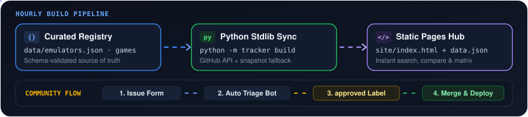
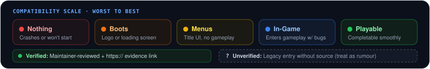

<div align="center">

<a href="https://its-zain-dev.github.io/ps5-emutrack/">
  
</a>

<br />

[](https://its-zain-dev.github.io/ps5-emutrack/)
[](https://github.com/its-zain-dev/ps5-emutrack/actions/workflows/pages.yml)
[](https://github.com/its-zain-dev/ps5-emutrack/actions/workflows/ci.yml)
[](LICENSE)

<br />

[Explore Live Hub](https://its-zain-dev.github.io/ps5-emutrack/) &nbsp;•&nbsp;
[Architecture](#how-it-works) &nbsp;•&nbsp;
[Compatibility Scale](#compatibility-scale) &nbsp;•&nbsp;
[Local CLI](#local-commands) &nbsp;•&nbsp;
[Submit Emulator](https://github.com/its-zain-dev/ps5-emutrack/issues/new?template=submit-emulator.yml) &nbsp;•&nbsp;
[Tracked Emulators](#tracked-emulators)

</div>

<br />


**PS5 EmuTrack** is an independent, open-source **PS5 emulator tracker** (**emulator track** & release monitor) for 65+ PlayStation 5 and related PS4 projects—including **KytyPS5**, **SharpEmu**, **AnyPS5**, **Prosperity**, **RPS5E**, **craziiEmu**, **arielPS5**, **Metaspero**, and **shadPS4**. It tracks hourly GitHub releases, verified compatibility reports, **malware & fake-repo alerts**, and our post-launch **GTA VI (GTA6 / GTA 6 PC / GTAVI emulator)** reality check—without hosting binaries, ROMs, firmware, or keys.

> [!WARNING]
> **Active Malware Alert (Nov 2026):** Following the November 19, 2026 console launch of *Grand Theft Auto VI* (with no official PC port yet), fake look-alike GitHub repos impersonating **AnyPS5** and **KytyPS5** (e.g. zero-code `GTA6-KytyPS5-*` clones) and fake GTA 6 PC installers are actively spreading infostealers and Microsoft Defender tampering malware. Always verify exact `owner/repo` links against this tracker and read our [Malware & Scam Alerts Guide](https://its-zain-dev.github.io/ps5-emutrack/guides/ps5-emulator-malware-warnings/).

## How it works

<p align="center">
  
</p>

| Layer | Location | Responsibility |
| :--- | :--- | :--- |
| **Curated Registry** | [`data/`](data/emulators.json) | Single source of truth for tracked emulators, games, and compatibility reports validated with JSON Schemas. |
| **Python Pipeline** | [`tracker/`](tracker/__main__.py) | Pure standard-library sync engine that fetches live repo stats & latest releases hourly with snapshot fallback. |
| **Static Web Hub** | [`site/`](site/index.html) | Zero-build frontend with spotlight search + suggestions, foldable directory, side-by-side comparison, and compatibility matrix. |
| **Issue Automation** | [`.github/workflows/`](.github/workflows/issues.yml) | Automated triage checks on submission/report issues and auto-commit on maintainer `approved` label. |

<br />


## Compatibility scale

<p align="center">
  
</p>

> [!NOTE]
> Every new compatibility report requires a maintainer review and a direct `https://` evidence link (video, screenshot, or log). Legacy v1 entries without recorded sources are clearly marked **unverified** so users can separate confirmed boots from rumours.

<br />


## Local commands

Requires **Python 3.11+** with **zero third-party dependencies**:

```bash
# Validate data/*.json against registry & schema rules
python -m tracker validate

# Regenerate the emulator tables in README.md (or verify with --check)
python -m tracker readme
python -m tracker readme --check

# Build site/data.json from GitHub API (set GITHUB_TOKEN to avoid the 60 req/hr limit)
GITHUB_TOKEN="$(gh auth token)" python -m tracker build

# Preview the static web hub locally
python -m http.server 8080 -d site

# Run unit tests
python -m unittest discover -s tests -v
```

<br />


## Contributing

| Action | Channel | Automated Checks |
| :--- | :--- | :--- |
| **Add an Emulator / Fork / Port** | [Submit Emulator Form ↗](https://github.com/its-zain-dev/ps5-emutrack/issues/new?template=submit-emulator.yml) | Verifies public GitHub repo, non-duplicate, license, and releases |
| **Report Game Compatibility** | [Compatibility Report Form ↗](https://github.com/its-zain-dev/ps5-emutrack/issues/new?template=compatibility-report.yml) | Verifies tracked emulator, game match/creation, and `https://` evidence link |
| **Direct Pull Request** | [CONTRIBUTING.md](CONTRIBUTING.md) | CI runs `validate`, `readme --check`, and `unittest` |

> [!CAUTION]
> PS5 EmuTrack strictly tracks open-source software and test results. It never hosts or links to games, firmware, BIOS files, or decryption keys.

<br />


## Tracked emulators

<!-- EMULATORS:START (generated by `python -m tracker readme`, do not edit by hand) -->
### Featured (5)

| Project | Category | Platforms | Notes |
| :-- | :-- | :-- | :-- |
| **[AnyPS5](https://github.com/boykopovar/AnyPS5)** ⭐ | PS5 emulator | Windows, Linux | Ahead-of-time (AOT) PS5 binary relinker that converts PS5 executables to run natively on Windows and Linux. |
| **[KytyPS5](https://github.com/KytyPS5/KytyPS5)** ⭐ | PS5 emulator | Windows, Linux, macOS | The most widely used open-source PS5 translation layer and emulator (C++20 + Vulkan 1.3) for Windows, Linux, and macOS. |
| **[Prosperity](https://github.com/Force67/prosperity)** ⭐ | PS5 emulator | Linux, Android | Low-level (LLE) emulator targeting both PS4 and PS5 hardware using dumped system modules and Vulkan 1.4+. |
| **[SharpEmu](https://github.com/sharpemu/sharpemu)** ⭐ | PS5 emulator | Windows, Linux | Experimental PS5 emulator written from scratch in C#/.NET with a Vulkan renderer and PS4 backward-compatibility work. |
| **[shadPS4](https://github.com/shadps4-emu/shadPS4)** ⭐ | PS4 & related | Windows, Linux, macOS | The leading PS4 emulator (150+ playable titles including Bloodborne). Many PS5 projects study its shader recompiler and HLE. |

### Full Directory by Category (68 total)

<details>
<summary><strong>PS5 emulator (29)</strong> — expand table</summary>

| Project | Platforms | Notes |
| :-- | :-- | :-- |
| **[AnyPS5](https://github.com/boykopovar/AnyPS5)** ⭐ | Windows, Linux | Ahead-of-time (AOT) PS5 binary relinker that converts PS5 executables to run natively on Windows and Linux. |
| **[KytyPS5](https://github.com/KytyPS5/KytyPS5)** ⭐ | Windows, Linux, macOS | The most widely used open-source PS5 translation layer and emulator (C++20 + Vulkan 1.3) for Windows, Linux, and macOS. |
| **[Prosperity](https://github.com/Force67/prosperity)** ⭐ | Linux, Android | Low-level (LLE) emulator targeting both PS4 and PS5 hardware using dumped system modules and Vulkan 1.4+. |
| **[SharpEmu](https://github.com/sharpemu/sharpemu)** ⭐ | Windows, Linux | Experimental PS5 emulator written from scratch in C#/.NET with a Vulkan renderer and PS4 backward-compatibility work. |
| [arielPS5](https://github.com/keirsalterego/arielPS5) | Windows, Linux, macOS | Clean-slate PlayStation 5 emulator and ELF64/SELF binary loader written in pure Rust focusing on format accuracy. |
| [Cincar](https://github.com/linuxfanosis/Cincar) | Linux | Early experimental C++ PlayStation 5 emulator project. |
| [CL5](https://github.com/SplaatSites/CL5) | Windows | Early-stage PlayStation 5 compatibility layer targeting Windows. |
| [craziiEmu](https://github.com/craze1pirate/craziiEmu) | Windows | Experimental Windows PlayStation 5 compatibility layer and emulator written in C# (.NET 10) with a Vulkan renderer. |
| [EmUV](https://github.com/sammwyy/EmUV) | Windows, Linux | Experimental x86-64 PlayStation 5 HLE compatibility layer mapping PS5 executables directly to host hardware. |
| [Metaspero](https://github.com/alamshafil/metaspero) | macOS, iOS | Experimental PlayStation 5 emulator and dynamic translation layer built for Apple Silicon macOS and iOS. |
| [Open5Emu](https://github.com/SplaatSites/Open5Emu) | Windows | Open-source early-stage PlayStation 5 emulator experiment. |
| [P5EMU](https://github.com/NabuOX/P5EMU) | Windows, Linux | Experimental C++ PS5 emulator architecture focused on portability and ARM64 translation research. |
| [PCS5](https://github.com/StoneCold608/PCS5) | Windows | Early community PlayStation 5 emulator research repository. |
| [Prosper](https://github.com/mattias800/prosper) | Windows, Linux, macOS | User-space PlayStation 5 to PC compatibility layer for Linux, Windows, and macOS. |
| [prospero-win](https://github.com/mpereiraesaa/prospero-win) | Windows | Windows compatibility runtime for native PlayStation 5 homebrew executables (C, LGPL-2.1). |
| [PS5 PC Emulator](https://github.com/mustafaaldaffaie/PS5-PC-Emulator) | Windows, Linux | Experimental PS5 compatibility layer and desktop frontend for Windows and Linux. |
| [PS5PCEM](https://github.com/iStark/PS5PCEM) | Windows, Linux | Open-source PS5 PC emulator project written in Zig targeting Windows and Linux hosts. |
| [PS5plusplus](https://github.com/thesupersupersigma/PS5plusplus) | Windows | Experimental C++ PlayStation 5 emulator project. |
| [ps5rs](https://github.com/claimore22/ps5rs) | Windows, Linux, macOS | Rust PS5 binary analysis, virtual loader, SELF/ELF/PRX parser, and pure-Rust HLE emulation framework. |
| [PSPC5 Plus](https://github.com/gurjotsenghww/pspc5-plus) | Windows | Open-source PlayStation 5 emulation and compatibility research written in Zig. |
| [RPS5E (RustPS5Emu)](https://github.com/keklick1337/rps5e) | Windows, Linux | Wine-style PlayStation 5 HLE compatibility layer written in Rust with Vulkan GPU command translation. |
| [RustPS5](https://github.com/CipherSoul01/RustPS5) | Windows, Linux | Experimental PlayStation 5 emulator written in Rust with a C# Avalonia desktop UI. |
| [S5-Play](https://github.com/danielsem65/S5-Play) | Windows | Experimental C++ PlayStation 5 / PS5 Pro emulator project for Windows. |
| [SharpEmu PS5 Mac](https://github.com/xxjonathan1997xx/SharpEmu-PS5-Mac) | macOS | Educational architectural prototype of a PlayStation 5 emulator built natively for macOS. |
| [Spogue5](https://github.com/tinirey/Spogue5) | Windows, Linux | Rust PS5 emulator prototype drawing on research from Kyty, SharpEmu, and shadPS4. |
| [Touche PX5](https://github.com/Techx3/TouchePX5) | Windows | Independent experimental C# PlayStation 5 emulator targeting Windows PCs. |
| [VibeStation5](https://github.com/Acelogic/VibeStation5) | macOS | Experimental native SwiftUI PS4/PS5 runtime for Apple Silicon inspired by SharpEmu. |
| [Zeno5](https://github.com/tossdace/Zeno5) | Windows | Early experimental C++ PlayStation 5 emulator project. |
| [ZylxEmu](https://github.com/zenunqq/zylxemu) | Windows | Experimental C# PlayStation 4 and PlayStation 5 emulator project. |

</details>

<details>
<summary><strong>Fork / custom build (10)</strong> — expand table</summary>

| Project | Platforms | Notes |
| :-- | :-- | :-- |
| [KytyPlus](https://github.com/Coder787-source/KytyPlus) | Windows, Linux | Based on KytyPS5 · KytyPS5-based fork adding extra HLE syscalls and experimental boot/crash fixes. |
| [KytyPS5 (chenxiao07 Linux build)](https://github.com/futbarista/KytyPS5-chenxiao07-linux) | Linux | Based on KytyPS5 · Linux build and launch scripts for chenxiao07's Demon's Souls KytyPS5 branch. |
| [KytyPS5 Carecu](https://github.com/carecu/KytyPS5) | Windows | Based on KytyPS5 · Community Windows fork and custom build of KytyPS5. |
| [KytyPS5 Demon Souls FrameGen](https://github.com/ceremony88/KytyPS5-DemonsSouls-FrameGen) | Windows | Based on KytyPS5 · Custom KytyPS5 build for Demon's Souls featuring DLSS Frame Generation and ultrawide patches. |
| [KytyPS5 GTA5 Fixes](https://github.com/CheesyPoofs346/KytyPS5-gta5-fixes) | Windows | Based on KytyPS5 · KytyPS5 fork with experimental Grand Theft Auto V (PS5) boot and rendering fixes. |
| [KytyPS5 Jetsku](https://github.com/Jetsku/KytyPS5) | Windows, Linux | Based on KytyPS5 · Experimental KytyPS5 branch merging shader, texture, and renderer fixes for Demon's Souls and more. |
| [KytyPS5 TMNT](https://github.com/edfwasd1234/KytyPS5-tmnt) | Windows | Based on KytyPS5 · KytyPS5 fork adding Unity and IL2CPP boot and rendering fixes. |
| [KytyPS5 Wolverine](https://github.com/loyalty3/KytyPS5-wolverine) | Windows | Based on KytyPS5 · KytyPS5 fork with experimental game-specific patches for Marvel's Wolverine. |
| [KytyPS5-SuperMedo](https://github.com/Supermedo/KytyPS5-SuperMedo) | Windows | Based on KytyPS5 · Windows KytyPS5 fork bundled with Kyty Launcher and DLSS frame generation enhancements. |
| [Nova5](https://github.com/nova5emu/nova5) | Windows, Linux | Based on KytyPS5 · Open-source PC PS5 emulator based on KytyPS5 featuring an integrated console-style launcher. |

</details>

<details>
<summary><strong>Port / frontend (20)</strong> — expand table</summary>

| Project | Platforms | Notes |
| :-- | :-- | :-- |
| [AnyPlay Launcher](https://github.com/anyplaynet/launcher) | Windows, Linux | Based on AnyPS5 · Rust console-style launcher for AnyPS5 games with controller, trophy, save, and online play support. |
| [AnyPS5-ARM](https://github.com/AnyTogether/AnyPS5-ARM) | macOS | Based on AnyPS5 · Apple Silicon macOS port of AnyPS5 for running relinked PlayStation 5 titles natively on Mac. |
| [AnyPS5 Desktop](https://github.com/AnyTogether/AnyPS5-Desktop) | Windows, Linux | Based on AnyPS5 · Flutter desktop frontend for AnyPS5 featuring a PS5-style home screen, saves, trophies, and controller support. |
| [AnyPS5 GUI](https://github.com/Lenny4250gh/AnyPS5-GUI) | Windows, Linux, macOS | Based on AnyPS5 · Cross-platform desktop GUI for AnyPS5 to unwrap, relink, configure, and launch PS5 game dumps. |
| [AnyPS5 Launcher](https://github.com/Tiberius1OOO/AnyPS5-Launcher) | Windows | Based on AnyPS5 · Standalone Windows launcher for AnyPS5 automating tool setup, binary conversion, and game launches. |
| [AnyPS5 OSX Edition](https://github.com/romangalaxys10-spec/AnyPS5-OSX) | macOS | Based on AnyPS5 · macOS port of AnyPS5 featuring a native Metal/MetalFX backend and Mach-O executable relinker. |
| [EmuFive](https://github.com/blue0x1/EmuFive) | PS4 | Based on KytyPS5 · Runs KytyPS5 on jailbroken PlayStation 4 consoles via Linux and PS4 Multiboot. |
| [KyTx](https://github.com/TxCsOffc/KyTx) | macOS | Based on KytyPS5 · Native ARM64 PS5 emulator port for Apple Silicon using FEX guest CPU translation and RDNA-to-MSL Metal. |
| [KytyPS5 Emscripten](https://github.com/Shubin123/kytyps5_emscripten) | Web | Based on KytyPS5 · Experimental WebAssembly and Emscripten browser port of KytyPS5. |
| [KytyPS5-Android](https://github.com/tarek369/KytyPS5-Android) | Android | Based on KytyPS5 · Experimental KytyPS5 Android ARM64 port using FEXCore JIT and Vulkan on Mesa Turnip/Adreno. |
| [Lumen Emu](https://github.com/gs-soft-it/lumen-emu) | Android, iOS | Experimental mobile PS4/PS5 emulator frontend for Android and iOS using open-source cores. |
| [madeira-anyps5](https://github.com/buberlo/madeira-anyps5) | iOS | Based on AnyPS5 · Research prototype running AnyPS5-relinked PS5 titles on iPad via Madeira (Wine ARM64EC + FEX) and MoltenVK. |
| [MagnusPS5](https://github.com/hernan0078/MagnusPS5) | iOS | Experimental PS5 emulator port targeting iOS devices (iPhone and iPad). |
| [NovaPS5 Android](https://github.com/kaminofilms/NovaPS5-Android) | Android | Experimental PlayStation 5 emulator port targeting Android ARM64 devices. |
| [onRps4-Android](https://github.com/dev-Ali2008/onRps4-Android) | Android | Experimental Android port exploring PlayStation 4 and PlayStation 5 emulation on mobile. |
| [Orbis-Kyty](https://github.com/MrKitsune9/Orbis-Kyty) | PS4 | Based on KytyPS5 · Test-only port exploring PS5 software execution on PlayStation 4 hardware via KytyPS5. |
| [PiesFive](https://github.com/pasttelstudios/PiesFive) | Windows | Based on KytyPS5 · Console-style PC game launcher powered by KytyPS5 with library management, profiles, saves, and trophies. |
| [SharpDroid](https://github.com/mircowuffwuff/sharpdroid) | Android | Based on SharpEmu · Experimental Android Kotlin app wrapping the SharpEmu PlayStation 5 runtime. |
| [SharpEmu Android](https://github.com/OniChan-little-GIRL/sharpemu-android) | Android | Based on SharpEmu · Experimental Android Material You 3 frontend and port for SharpEmu PS4/PS5 emulation. |
| [SharpEmu for Mac](https://github.com/sharpemu/sharpemu-mac) | macOS | Based on SharpEmu · Official experimental macOS companion port of the SharpEmu PlayStation 5 emulator. |

</details>

<details>
<summary><strong>PS4 & related (9)</strong> — expand table</summary>

| Project | Platforms | Notes |
| :-- | :-- | :-- |
| **[shadPS4](https://github.com/shadps4-emu/shadPS4)** ⭐ | Windows, Linux, macOS | The leading PS4 emulator (150+ playable titles including Bloodborne). Many PS5 projects study its shader recompiler and HLE. |
| [AetherPS4](https://github.com/Leviidev/AetherPS4) | iOS | Open-source PlayStation 4 emulator core and standalone application built for iOS and iPadOS. |
| [Empire of Steel](https://github.com/daeken/EmpireOfSteel) | Windows, Linux | Prototype C# PlayStation 4 and PlayStation 5 emulator research project. |
| [fpPS4](https://github.com/red-prig/fpPS4) | Windows, Linux | PS4 compatibility layer and emulator written in Free Pascal for Windows and Linux. |
| [GPCS4](https://github.com/Inori/GPCS4) | Windows | Work-in-progress PlayStation 4 emulator for Windows. |
| [Kyty (Upstream)](https://github.com/InoriRus/Kyty) | Windows, Linux | Upstream PS4 and PS5 emulator by InoriRus for Windows and Linux. |
| [Obliteration](https://github.com/obhq/obliteration) | Windows, Linux, macOS | Free and open-source PlayStation 4 kernel and compatibility layer written in Rust. |
| [Orbital](https://github.com/AlexAltea/orbital) | Windows, Linux | Experimental low-level PlayStation 4 emulator using hardware virtualization. |
| [psOff](https://github.com/SysRay/psOff_public) | Windows | PlayStation 4 compatibility layer and emulator for Windows. |

</details>
<!-- EMULATORS:END -->
