<div align="center">

<a href="https://its-zain-dev.github.io/ps5-emutrack/">
  
</a>

<br />

[](https://its-zain-dev.github.io/ps5-emutrack/)
[](https://github.com/its-zain-dev/ps5-emutrack/actions/workflows/pages.yml)
[](https://github.com/its-zain-dev/ps5-emutrack/actions/workflows/ci.yml)
[](LICENSE)

<br />

[Explore Live Hub](https://its-zain-dev.github.io/ps5-emutrack/) &nbsp;•&nbsp;
[Architecture](#how-it-works) &nbsp;•&nbsp;
[Compatibility Scale](#compatibility-scale) &nbsp;•&nbsp;
[Local CLI](#local-commands) &nbsp;•&nbsp;
[Submit Emulator](https://github.com/its-zain-dev/ps5-emutrack/issues/new?template=submit-emulator.yml) &nbsp;•&nbsp;
[Tracked Emulators](#tracked-emulators)

</div>

<br />


**PS5 EmuTrack** is an independent, open-source **PS5 emulator tracker** (**emulator track** & release monitor) for PlayStation 5 and related PS4 projects—including **KytyPS5**, **SharpEmu**, **AnyPS5**, **Prosperity**, and **shadPS4**. It tracks hourly GitHub releases, verified compatibility reports, and our **GTA VI (GTA6 / GTA 6 PC / GTAVI emulator)** launch reality check—without hosting binaries, ROMs, firmware, or keys.

## How it works

<p align="center">
  
</p>

| Layer | Location | Responsibility |
| :--- | :--- | :--- |
| **Curated Registry** | [`data/`](data/emulators.json) | Single source of truth for tracked emulators, games, and compatibility reports validated with JSON Schemas. |
| **Python Pipeline** | [`tracker/`](tracker/__main__.py) | Pure standard-library sync engine that fetches live repo stats & latest releases hourly with snapshot fallback. |
| **Static Web Hub** | [`site/`](site/index.html) | Zero-build frontend with spotlight search + suggestions, foldable directory, side-by-side comparison, and compatibility matrix. |
| **Issue Automation** | [`.github/workflows/`](.github/workflows/issues.yml) | Automated triage checks on submission/report issues and auto-commit on maintainer `approved` label. |

<br />


## Compatibility scale

<p align="center">
  
</p>

> [!NOTE]
> Every new compatibility report requires a maintainer review and a direct `https://` evidence link (video, screenshot, or log). Legacy v1 entries without recorded sources are clearly marked **unverified** so users can separate confirmed boots from rumours.

<br />


## Local commands

Requires **Python 3.11+** with **zero third-party dependencies**:

```bash
# Validate data/*.json against registry & schema rules
python -m tracker validate

# Regenerate the emulator tables in README.md (or verify with --check)
python -m tracker readme
python -m tracker readme --check

# Build site/data.json from GitHub API (set GITHUB_TOKEN to avoid the 60 req/hr limit)
GITHUB_TOKEN="$(gh auth token)" python -m tracker build

# Preview the static web hub locally
python -m http.server 8080 -d site

# Run unit tests
python -m unittest discover -s tests -v
```

<br />


## Contributing

| Action | Channel | Automated Checks |
| :--- | :--- | :--- |
| **Add an Emulator / Fork / Port** | [Submit Emulator Form ↗](https://github.com/its-zain-dev/ps5-emutrack/issues/new?template=submit-emulator.yml) | Verifies public GitHub repo, non-duplicate, license, and releases |
| **Report Game Compatibility** | [Compatibility Report Form ↗](https://github.com/its-zain-dev/ps5-emutrack/issues/new?template=compatibility-report.yml) | Verifies tracked emulator, game match/creation, and `https://` evidence link |
| **Direct Pull Request** | [CONTRIBUTING.md](CONTRIBUTING.md) | CI runs `validate`, `readme --check`, and `unittest` |

> [!CAUTION]
> PS5 EmuTrack strictly tracks open-source software and test results. It never hosts or links to games, firmware, BIOS files, or decryption keys.

<br />


## Tracked emulators

<!-- EMULATORS:START (generated by `python -m tracker readme`, do not edit by hand) -->
### Featured (5)

| Project | Category | Platforms | Notes |
| :-- | :-- | :-- | :-- |
| **[AnyPS5](https://github.com/boykopovar/AnyPS5)** ⭐ | PS5 emulator | Windows, Linux | Ports PS5 executables to run natively on Linux and Windows through automatic re-linking. |
| **[KytyPS5](https://github.com/KytyPS5/KytyPS5)** ⭐ | PS5 emulator | Windows, Linux, macOS | The most widely used PS5 translation layer. Runs PS5 executables on Windows, Linux and macOS. |
| **[Prosperity](https://github.com/Force67/prosperity)** ⭐ | PS5 emulator | — | Low-level (LLE) emulator targeting both PS4 and PS5 hardware. |
| **[SharpEmu](https://github.com/sharpemu/sharpemu)** ⭐ | PS5 emulator | Windows, Linux | Experimental PS5 emulator written in C#/.NET with a Vulkan renderer, for Windows and Linux. |
| **[shadPS4](https://github.com/shadps4-emu/shadPS4)** ⭐ | PS4 & related | Windows, Linux, macOS | The leading PS4 emulator. Many PS5 projects reuse its shader recompiler and HLE work. |

### Full Directory by Category (53 total)

<details>
<summary><strong>PS5 emulator (24)</strong> — expand table</summary>

| Project | Platforms | Notes |
| :-- | :-- | :-- |
| **[AnyPS5](https://github.com/boykopovar/AnyPS5)** ⭐ | Windows, Linux | Ports PS5 executables to run natively on Linux and Windows through automatic re-linking. |
| **[KytyPS5](https://github.com/KytyPS5/KytyPS5)** ⭐ | Windows, Linux, macOS | The most widely used PS5 translation layer. Runs PS5 executables on Windows, Linux and macOS. |
| **[Prosperity](https://github.com/Force67/prosperity)** ⭐ | — | Low-level (LLE) emulator targeting both PS4 and PS5 hardware. |
| **[SharpEmu](https://github.com/sharpemu/sharpemu)** ⭐ | Windows, Linux | Experimental PS5 emulator written in C#/.NET with a Vulkan renderer, for Windows and Linux. |
| [Cincar](https://github.com/linuxfanosis/Cincar) | — | — |
| [CL5](https://github.com/SplaatSites/CL5) | — | — |
| [Open5Emu](https://github.com/SplaatSites/Open5Emu) | — | — |
| [P5EMU](https://github.com/NabuOX/P5EMU) | — | — |
| [PCS5](https://github.com/StoneCold608/PCS5) | — | — |
| [Prosper](https://github.com/mattias800/prosper) | Windows, Linux, macOS | User-space PlayStation 5 to PC compatibility layer for Linux, Windows, and macOS. |
| [PS5 PC Emulator](https://github.com/mustafaaldaffaie/PS5-PC-Emulator) | — | Experimental PS5 compatibility layer and desktop frontend for Windows and Linux. |
| [PS5PCEM](https://github.com/iStark/PS5PCEM) | Windows, Linux | Open-source PS5 PC emulator project targeting Windows and Linux hosts. |
| [PS5plusplus](https://github.com/thesupersupersigma/PS5plusplus) | — | — |
| [ps5rs](https://github.com/claimore22/ps5rs) | Windows, Linux, macOS | Rust PS5 binary analysis, virtual loader, SELF/ELF/PRX parser, and pure-Rust HLE emulation framework. |
| [PSPC5 Plus](https://github.com/gurjotsenghww/pspc5-plus) | Windows | — |
| [RPS5E (RustPS5Emu)](https://github.com/keklick1337/rps5e) | Windows, Linux | PlayStation 5 emulator written in Rust targeting Linux and Windows hosts. |
| [RustPS5](https://github.com/CipherSoul01/RustPS5) | — | — |
| [S5-Play](https://github.com/danielsem65/S5-Play) | Windows | — |
| [SharpEmu PS5 Mac](https://github.com/xxjonathan1997xx/SharpEmu-PS5-Mac) | macOS | — |
| [Spogue5](https://github.com/tinirey/Spogue5) | — | — |
| [Touche PX5](https://github.com/Techx3/TouchePX5) | — | — |
| [VibeStation5](https://github.com/Acelogic/VibeStation5) | macOS | — |
| [Zeno5](https://github.com/tossdace/Zeno5) | — | — |
| [ZylxEmu](https://github.com/zenunqq/zylxemu) | — | — |

</details>

<details>
<summary><strong>Fork / custom build (9)</strong> — expand table</summary>

| Project | Platforms | Notes |
| :-- | :-- | :-- |
| [KytyPlus](https://github.com/Coder787-source/KytyPlus) | Windows, Linux | Based on KytyPS5 |
| [KytyPS5 (chenxiao07 Linux build)](https://github.com/futbarista/KytyPS5-chenxiao07-linux) | — | Based on KytyPS5 |
| [KytyPS5 Carecu](https://github.com/carecu/KytyPS5) | — | Based on KytyPS5 |
| [KytyPS5 Demon Souls FrameGen](https://github.com/ceremony88/KytyPS5-DemonsSouls-FrameGen) | — | Based on KytyPS5 |
| [KytyPS5 GTA5 Fixes](https://github.com/CheesyPoofs346/KytyPS5-gta5-fixes) | — | Based on KytyPS5 · KytyPS5 fork with game-specific fixes. |
| [KytyPS5 Jetsku](https://github.com/Jetsku/KytyPS5) | — | Based on KytyPS5 |
| [KytyPS5 TMNT](https://github.com/edfwasd1234/KytyPS5-tmnt) | — | Based on KytyPS5 |
| [KytyPS5 Wolverine](https://github.com/loyalty3/KytyPS5-wolverine) | — | Based on KytyPS5 · KytyPS5 fork with game-specific fixes. |
| [KytyPS5-SuperMedo](https://github.com/Supermedo/KytyPS5-SuperMedo) | Windows | Based on KytyPS5 |

</details>

<details>
<summary><strong>Port / frontend (12)</strong> — expand table</summary>

| Project | Platforms | Notes |
| :-- | :-- | :-- |
| [EmuFive](https://github.com/blue0x1/EmuFive) | PS4 | Based on KytyPS5 |
| [KyTx](https://github.com/TxCsOffc/KyTx) | macOS | Based on KytyPS5 |
| [KytyPS5 Emscripten](https://github.com/Shubin123/kytyps5_emscripten) | Web | Based on KytyPS5 |
| [KytyPS5-Android](https://github.com/tarek369/KytyPS5-Android) | Android | Based on KytyPS5 · Experimental KytyPS5 Android ARM64 port using FEXCore JIT and Vulkan on Mesa Turnip/Adreno. |
| [Lumen Emu](https://github.com/gs-soft-it/lumen-emu) | Android, iOS | Experimental mobile PS4/PS5 emulator frontend for Android and iOS using open-source cores. |
| [MagnusPS5](https://github.com/hernan0078/MagnusPS5) | iOS | Experimental PS5 emulator port targeting iOS devices (iPhone and iPad). |
| [NovaPS5 Android](https://github.com/kaminofilms/NovaPS5-Android) | Android | — |
| [onRps4-Android](https://github.com/dev-Ali2008/onRps4-Android) | Android | — |
| [Orbis-Kyty](https://github.com/MrKitsune9/Orbis-Kyty) | PS4 | Based on KytyPS5 |
| [SharpDroid](https://github.com/mircowuffwuff/sharpdroid) | Android | Based on SharpEmu |
| [SharpEmu Android](https://github.com/OniChan-little-GIRL/sharpemu-android) | Android | Based on SharpEmu |
| [SharpEmu for Mac](https://github.com/sharpemu/sharpemu-mac) | macOS | Based on SharpEmu |

</details>

<details>
<summary><strong>PS4 & related (8)</strong> — expand table</summary>

| Project | Platforms | Notes |
| :-- | :-- | :-- |
| **[shadPS4](https://github.com/shadps4-emu/shadPS4)** ⭐ | Windows, Linux, macOS | The leading PS4 emulator. Many PS5 projects reuse its shader recompiler and HLE work. |
| [Empire of Steel](https://github.com/daeken/EmpireOfSteel) | — | — |
| [fpPS4](https://github.com/red-prig/fpPS4) | Windows, Linux | PS4 compatibility layer and emulator written in Free Pascal for Windows and Linux. |
| [GPCS4](https://github.com/Inori/GPCS4) | Windows | Work-in-progress PlayStation 4 emulator for Windows. |
| [Kyty (Upstream)](https://github.com/InoriRus/Kyty) | Windows, Linux | Upstream PS4 and PS5 emulator by InoriRus for Windows and Linux. |
| [Obliteration](https://github.com/obhq/obliteration) | Windows, Linux, macOS | Free and open-source PlayStation 4 kernel and compatibility layer. |
| [Orbital](https://github.com/AlexAltea/orbital) | Windows, Linux | Experimental low-level PlayStation 4 emulator using virtualization. |
| [psOff](https://github.com/SysRay/psOff_public) | Windows | PlayStation 4 compatibility layer and emulator for Windows. |

</details>
<!-- EMULATORS:END -->
